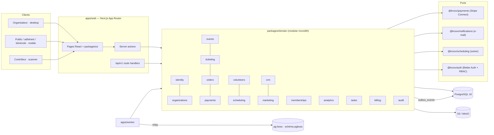

# Kroov — Architecture

Version : Phase 1 (identité et organisations) · 28 octobre 2026.

Kroov est un **monolithe modulaire** TypeScript strict déployé en deux processus (web + worker) autour d'une base PostgreSQL unique et autoritaire. Les modules métier vivent dans `packages/domain` et exposent chacun une API publique ; aucune table n'est manipulée depuis un module étranger.

## 1. Vue d'ensemble



## 2. Décisions structurantes

| Sujet         | Décision                                                                                                                        | ADR               |
| ------------- | ------------------------------------------------------------------------------------------------------------------------------- | ----------------- |
| Monorepo      | pnpm workspaces + Turborepo ; packages consommés en source TS (pas de build intermédiaire)                                      | ADR-001           |
| Web           | Next.js 16 App Router, React 19, Tailwind v4, composants style shadcn/ui dans `@kroov/ui`                                       | ADR-001           |
| Base          | PostgreSQL 16, Drizzle ORM, migrations SQL versionnées (`drizzle-kit generate` + runner maison), jamais de `push` en production | ADR-002           |
| Jobs          | pg-boss (file durable dans PostgreSQL, schéma `pgboss`) + outbox transactionnel                                                 | ADR-003           |
| Auth          | Better Auth (sessions en base) + RBAC maison deny-by-default, permissions atomiques à périmètre organisation / événement        | ADR-004 (phase 1) |
| Paiement      | Port `PaymentProviderPort` ; adaptateur Stripe Connect en phase 3 ; aucun billet sans confirmation serveur                      | ADR-005 (phase 3) |
| Lint / format | Biome (un seul outil, rapide, règles a11y)                                                                                      | ADR-001           |
| Tests         | Vitest (unit / integration / security) + Playwright (desktop 1440 et mobile 390)                                                | ADR-001           |
| Argent        | Entiers en unités mineures + code ISO 4217 ; type `Money` dans le noyau partagé                                                 | ADR-002           |
| Horodatage    | `timestamptz` partout, rendu Europe/Paris côté application                                                                      | ADR-002           |

## 3. Organisation du dépôt

```
apps/web              Next.js : espaces organisateur, public, personnel, scanner, /api/v1
apps/worker           pg-boss : relais outbox, maintenance, (phase 6) runs de planning
packages/config       tsconfig partagés, schéma d'environnement (zod), constantes
packages/validation   schémas zod réutilisables, messages d'erreur en français
packages/database     client Drizzle, schéma, migrations SQL, helpers de test
packages/domain       modules métier + noyau partagé (erreurs, Result, Money, machine à états) + authorization (RBAC)
packages/auth         catalogue permissions / rôles ("@kroov/auth"), instance Better Auth ("@kroov/auth/server")
packages/ui           tokens de design, primitives, shells (organisation / public / contrôle)
packages/payments     port fournisseur de paiement
packages/notifications port e-mail + adaptateurs console / file (tests) / smtp, gabarit transactionnel
packages/scheduling   contrat du moteur de planning (entrée immuable → proposition)
tests/integration     tests sur PostgreSQL réel (DATABASE_URL_TEST)
tests/security        tests négatifs (secrets, isolation tenant à partir de la phase 1)
tests/e2e             Playwright
docs                  architecture, ADR, rapports de phase, captures
infra                 docker-compose (Postgres, MinIO, Mailpit)
```

## 4. Règles de dépendance entre modules

1. `kernel` ne dépend de rien. Tout module peut en dépendre.
2. Un module importe un autre module **uniquement** via son `index.ts` (API publique).
3. Un module n'écrit jamais dans les tables d'un autre module. Il appelle une commande du module propriétaire.
4. Les routes (`apps/web`) ne contiennent aucune règle métier : validation → appel de service avec un `Actor` → mapping des erreurs.
5. Les effets de bord inter-modules passent par des événements typés écrits dans `outbox_events` **dans la même transaction** que la modification d'état.

Phases d'implémentation par module : identity/organizations/audit (1 — livrés), events (2), ticketing/orders/payments (3), memberships (4), volunteers (5), scheduling (6), crm (7), marketing (8), analytics/tasks (9), billing/audit (transverses, à partir de 1).

## 5. Noyau partagé (`packages/domain/src/kernel`)

- `DomainError` et sous-classes : codes stables (`not_found`, `forbidden`, `conflict`, `invalid_transition`, …) → statut HTTP via `httpStatusFor`.
- `Result<T, E>` : les commandes qui peuvent échouer pour une raison métier renvoient un résultat explicite.
- `Money` : entiers en unités mineures, opérations vérifiées, `applyBasisPoints` pour les frais, `formatMoney` en typographie française.
- `StateMachine` : graphe de transitions typé + gardes, journalise acteur/raison, exporte un diagramme Mermaid. Chaque machine métier (événement, commande, paiement, billet, adhésion, candidature, version de planning, campagne) sera déclarée avec cet outil et **aucun PATCH générique ne modifiera un statut**.
- `Actor` : qui exécute une commande (utilisateur, système, webhook, anonyme). Tout service reçoit un acteur et autorise côté serveur.

## 6. Base de données

- UUID générés par PostgreSQL (`gen_random_uuid()`), `timestamptz`, `snake_case`.
- Contraintes relationnelles en base : FK explicites, index uniques partiels, `CHECK`.
- Migrations : `pnpm db:generate` (drizzle-kit, SQL versionné dans `packages/database/migrations`) puis `pnpm db:migrate` (runner idempotent, table `public.drizzle_migrations`). `pnpm db:check` vérifie la cohérence schéma / migrations en CI.
- Phase 0 (INFRASTRUCTURE) : `idempotency_records`, `outbox_events`, `job_executions`, `feature_flags`.
- Phase 1 (AUTH + IDENTITY) : tables Better Auth, `user_profiles`, `organizations`, `organization_settings`, `organization_members`, `roles`, `permissions`, `role_permissions`, `member_role_assignments` (FK composite tenant-safe), `organization_invitations`, `audit_logs` ; FK `organization_id` sur les tables infra.
- Diagramme ER : `docs/er-diagram.md` (mis à jour à chaque phase).

## 7. Processus worker

- pg-boss démarre dans le schéma `pgboss` de la même base ; files déclarées dans `apps/worker/src/queue.ts` (`QUEUES`), politique commune : 5 tentatives, backoff exponentiel, conservation 7 jours.
- Relais outbox : `SELECT … FOR UPDATE SKIP LOCKED` par lots de 100, marquage `dispatched`, backoff par ligne, échec définitif après 10 tentatives. Balayage de sûreté chaque minute ; les producteurs déclencheront le relais directement après commit (phase 1).
- Maintenance : purge horaire des `idempotency_records` expirés, heartbeat chaque minute.
- Arrêt propre sur SIGINT/SIGTERM (`stop({ graceful: true })`, fermeture du pool).

## 7bis. Autorisation (phase 1)

`requirePermission(db, actor, permission, { organizationId, eventId? })` charge en une requête les attributions de rôle de l'acteur dans l'organisation (membres actifs uniquement) et accorde la permission si une attribution organisation-wide ou une attribution limitée à `eventId` la porte. Deny by default ; les acteurs `system` / `webhook` contournent le RBAC mais restent scoppés par organisation. Les lectures d'organisation par un non-membre renvoient 404 ; les mutations 403. Le dernier propriétaire est protégé dans une transaction avec verrou `FOR UPDATE` sur l'organisation.

## 8. Sécurité (fondation)

- Environnement validé au démarrage (`packages/config/src/env.ts`) : échec explicite, chaînes vides = non configuré, secrets sans valeur par défaut.
- En-têtes HTTP : `nosniff`, `X-Frame-Options: DENY`, `Referrer-Policy`, `Permissions-Policy` (caméra autorisée en `self` pour le scanner).
- Logs structurés pino avec redaction (`authorization`, `cookie`, `*.password`, `*.secret`, `*.token`, `*.qrCredential`).
- `scripts/scan-secrets.mjs` exécuté par `tests/security` et en CI.
- Page `/design-system` : 404 en production (données de démonstration non servies).

## 9. Design system

Tokens issus du kit UX (`tokens.json`, livraison 1.0) déclarés en `@theme` Tailwind v4 dans `packages/ui/src/styles.css` et miroir TypeScript dans `tokens.ts`. Composants livrés en phase 0 : `Button` (primaire lime / secondaire / solide / danger / discret, chargement et raison de désactivation), `Badge`/`StatusBadge`, `Panel`, `PageHeader`, `Eyebrow`, `Stat`/`StatGrid` (skeleton, jamais de faux « 0 »), `FormField` + `Input`/`Textarea`/`Select`/`PasswordInput` (label permanent, aide, erreur `aria-describedby`), `EmptyState`, `ErrorState`, `ForbiddenState`, `LoadingState`, `Alert`, `Wordmark` (remplaçable par le SVG officiel), shells `OrganizationShell` (214 px / 76 px / drawer < 1024 px), `PublicShell` (nav basse 4 entrées), `CheckInShell` (Scanner · Rechercher · Journal).

Référence visuelle : `/design-system` en développement ; captures dans `docs/captures/`.
