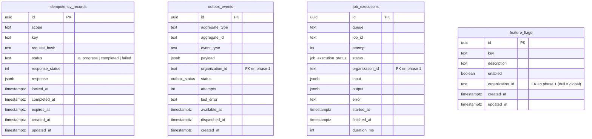

# Diagramme entité-relation

Mis à jour à chaque phase. Phase 0 : domaine INFRASTRUCTURE uniquement (sans FK tenant ; la table `organizations` arrive en phase 1 et les colonnes `organization_id` ci-dessous recevront alors leur clé étrangère).

Contraintes :

| Table               | Contrainte                                                        | Rôle                                         |
| ------------------- | ----------------------------------------------------------------- | -------------------------------------------- |
| idempotency_records | `UNIQUE (scope, key)`                                             | un seul enregistrement par clé d'idempotence |
| idempotency_records | `CHECK char_length(key) BETWEEN 1 AND 255`                        | clés bornées                                 |
| outbox_events       | index partiel `(available_at) WHERE status = 'pending'`           | relais efficace                              |
| outbox_events       | `CHECK attempts >= 0`                                             |                                              |
| job_executions      | `UNIQUE (job_id, attempt)`                                        | une ligne par tentative                      |
| feature_flags       | `UNIQUE (key) WHERE organization_id IS NULL`                      | un drapeau global par clé                    |
| feature_flags       | `UNIQUE (key, organization_id) WHERE organization_id IS NOT NULL` | une surcharge par organisation               |
| feature_flags       | `CHECK key ~ '^[a-z0-9_.-]{2,80}$'`                               | clés normalisées                             |
